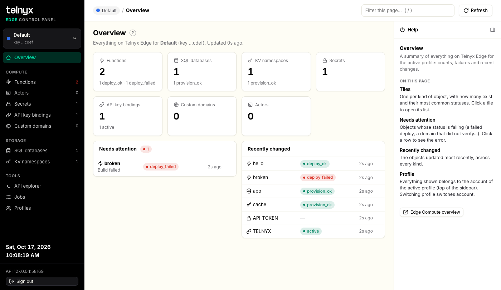

# Telnyx Edge for Mac and Windows

A desktop app for managing **Telnyx Edge Compute**: functions, SQL databases, KV namespaces, secrets, API key bindings, custom domains and actors. You can switch between several Telnyx accounts without signing in again each time.

> This is an open-source tool, provided as is under the [MIT License](LICENSE). It is not an officially supported Telnyx product.

## What you need

- **A Mac with macOS 13 Ventura or later**, Apple silicon or Intel.
  **Or a PC with Windows 11**, Intel/AMD or ARM.
- **A Telnyx API key** for each account you want to manage, with access to Edge Compute. You can create one in the [Telnyx portal → API Keys](https://portal.telnyx.com/#/api-keys).

You don't need to install anything else. The app includes everything it needs, including its own copy of Node.js.

## Install

Open the [latest release](https://github.com/team-telnyx/telnyx-edge-gui/releases/latest) and download the file for your computer:

| Computer | Download |
|---|---|
| Mac | `TelnyxEdge-<version>.dmg` |
| Windows 11, most PCs (Intel or AMD) | `TelnyxEdge-<version>-win-x64-Setup.exe` |
| Windows 11 on ARM (e.g. Snapdragon laptops) | `TelnyxEdge-<version>-win-arm64-Setup.exe` |

If you're not sure which Windows PC you have, open **Settings → System → About** and look at *System type*.

**Mac:** open the `.dmg` and drag **Telnyx Edge** onto **Applications**, then open it from Applications.

**Windows:** run the `Setup.exe`. It installs just for you, so it doesn't need admin rights, and adds **Telnyx Edge** to the Start menu. There's also a portable `.zip` you can extract and run `TelnyxEdge.exe` from, without installing.

### The first time you open it

The app isn't signed with a paid Apple or Microsoft certificate. So the first time you open each new version, your computer warns you and asks you to approve it:

- **Mac:** click **Done**, then go to **System Settings → Privacy & Security → Open Anyway**. Or run one Terminal command:
  `xattr -dr com.apple.quarantine "/Applications/Telnyx Edge.app"`
- **Windows:** on *Windows protected your PC*, click **More info → Run anyway**.

**[Step-by-step guide for every macOS and Windows version →](docs/APPROVING-UNSIGNED-APPS.md)**
It also covers company-managed computers, Windows Smart App Control, and how to check that your download is genuine.

## First sign-in

1. Paste a Telnyx API key, and optionally give it a name, such as *Acme production*.
2. Leave **Remember on this Mac / PC** ticked if you want the app to sign you in automatically next time.
3. Click **Sign in**. The key is checked with Telnyx before you get in.
4. **Mac only:** macOS may ask whether *TelnyxEdge* may use *Telnyx Edge saved sign-ins* in your keychain. Enter your Mac password and click **Always Allow**.

From then on, the app opens straight into the account you used last.

## How it works

- **Profiles.** A profile is a named, colour-coded Telnyx API key. Add one per account or environment on the **Profiles** page, and switch between them from the menu at the top of the sidebar. Every page shows data for the profile you've selected.
- **Your vault.** Your profiles are stored in an encrypted *vault* on your computer. The key you signed in with is what unlocks it, so signing in with a different key opens a different vault with its own profiles.
- **Saved sign-ins.** Keys you choose to remember are kept by your operating system, not by the app. On a Mac that's the **Keychain**. On Windows it's **Credential Manager**, under *Windows Credentials* as `TelnyxEdge/…`. When you sign out, the sign-in screen lists them so you can pick one.
- **Everything stays on your computer.** The app runs a small private server that only your computer can reach. It talks directly to `api.telnyx.com` using the selected profile's key. The window only ever shows the last four characters of a key.
- **Working with Edge objects.** Each object type has a page with a filterable list and actions to open, edit, duplicate and delete. Deleting a function, database or namespace asks you to type its name first. There's also:
  - an **SQL console**;
  - a **KV key browser**;
  - **function metrics, logs and revisions**, with rollback;
  - the **region** each function is running in (see [Regions](#regions));
  - an **API explorer** for any `/v2/compute` or `/v2/storage` request.
- **Help on every page.** Hover the **?** next to a page title for what the page is for and a link to the Telnyx docs. The **Help** column on the right explains everything on the current page and tab; collapse it with the button at its top.
- **Links and downloads.** Links to other sites open in your browser. SQL exports ask where to save the file.

### App menu

| | Mac: **Telnyx Edge** menu | Windows: window menu (**Alt+Space**, or right-click the title bar) |
|---|---|---|
| Open the folder with your profiles | Show Data Folder in Finder | Show data folder |
| Forget every saved key | Forget All Saved Sign-ins… | Forget all saved sign-ins… |
| Reload / zoom | View menu, ⌘R, ⌘+ / ⌘− | F5, Ctrl + / Ctrl − |

## Removing profiles and keys

| To… | Do this | What happens |
|---|---|---|
| Stop the app remembering a key | On the sign-in screen, click the 🗑 next to it. To remove all of them at once, use *Forget all saved sign-ins* in the [app menu](#app-menu). | The key is removed from the Keychain or Credential Manager. The vault and its profiles stay, and come back if you sign in with that key again. |
| Remove one profile | **Profiles** page → 🗑 on that row | The profile is removed from your vault. Nothing changes on Telnyx. |
| Remove everything for a key | **Profiles** page → 🗑 on the row marked *sign-in key* → type its name → **Delete vault** | Every profile in that vault is deleted, you're signed out, and the saved key is removed. Nothing changes on Telnyx. |

## Regions

The **Functions** page has a **Region** column, and each function's overview has a **Region** card. They show where the function's requests actually ran, for example `us-east-2`.

- **Where it comes from.** Telnyx reports the region on each request, not on the function itself. The app reads the function's requests from the last 24 hours (up to 250 of them) and lists the regions it finds, busiest first. If there is more than one, each shows its share of those requests.
- **`—` means no recent requests.** A function that served nothing in the last 24 hours has no region to show yet. Send it a request and refresh.
- **`?` means the request logs couldn't be read** for that function.
- **You can't choose the region.** Telnyx decides where functions run, and it doesn't accept a region when you create a function, an SQL database or a KV namespace. That's why the app has no region selector. SQL databases and KV namespaces show no region, because Telnyx doesn't report one for them.
- The column is filled in a moment after the list appears, and it's refreshed at most once a minute. The filter box matches regions too.

## Updating

Download the newer version from [Releases](https://github.com/team-telnyx/telnyx-edge-gui/releases), then:

- **Mac:** drag the app to Applications again and choose **Replace**.
- **Windows:** run the new `Setup.exe`. It closes the running app and updates it in place.

Approve the new version once, as in [The first time you open it](#the-first-time-you-open-it). Your profiles and saved sign-ins are kept. What changed in each version is in [CHANGELOG.md](CHANGELOG.md). On a Mac, click **Always Allow** if the Keychain asks again.

## Uninstalling

| | Mac | Windows |
|---|---|---|
| The app | Drag **Telnyx Edge** from Applications to the Bin | **Settings → Apps → Installed apps → Telnyx Edge → Uninstall** (or delete the portable folder) |
| Your profiles | Delete `~/Library/Application Support/Telnyx Edge Control Panel` | Delete `%LOCALAPPDATA%\Telnyx Edge Control Panel` |
| Saved keys | **Keychain Access** → search *Telnyx Edge saved sign-ins* → delete | **Credential Manager → Windows Credentials** → remove each `TelnyxEdge/…` entry |

Removing the app keeps your profiles and saved keys, so reinstalling brings them back. Delete them as above if you want them gone.

## Troubleshooting

| Problem | Fix |
|---|---|
| The Mac says *Not Opened* or *is damaged*; Windows says *Windows protected your PC* or *Smart App Control blocked…* | See [Opening Telnyx Edge when your computer blocks it](docs/APPROVING-UNSIGNED-APPS.md). |
| Sign-in fails with *Telnyx rejected this API key* | The key is wrong, revoked, or has no Edge Compute access. Create a new key in the Telnyx portal. |
| The Mac asks for the Keychain password on every launch | You clicked *Allow* instead of *Always Allow*. Click **Always Allow** next time it asks. |
| Windows: *The Microsoft Edge WebView2 Runtime is not installed* | It comes with Windows 11. On other systems, [install it from Microsoft](https://go.microsoft.com/fwlink/p/?LinkId=2124703). |
| *The panel server stopped* | Quit and reopen the app. Your profiles are safe. If it keeps happening, send the developer the log. On Windows it's `%LOCALAPPDATA%\Telnyx Edge Control Panel\logs\app.log`. On a Mac, run `"/Applications/Telnyx Edge.app/Contents/MacOS/TelnyxEdge"` in Terminal and copy what it prints. |
| A save or delete fails with a Telnyx error | The error message comes straight from Telnyx. Changes to Edge objects follow the request formats of the `telnyx-edge` CLI, and Telnyx may have changed them. You can send a corrected request from the **API explorer**. |
| A function's **Region** shows `—` | It served no requests in the last 24 hours, so there is nothing to read the region from. See [Regions](#regions). |
| You're signed out after a while | Sessions end after 8 hours without use, or 24 hours in total. Pick your saved sign-in to continue. |

## For developers

For building, testing, the web version and releasing, see [docs/DEVELOPMENT.md](docs/DEVELOPMENT.md). To propose a change, see [CONTRIBUTING.md](CONTRIBUTING.md). To report a security problem, see [SECURITY.md](SECURITY.md).

## License

The code is released under the [MIT License](LICENSE). The software is provided as is, without warranty of any kind.

The Telnyx name and logo are trademarks of Telnyx and are not covered by the MIT License. The bundled Inter font and Node.js have their own licenses: see [THIRD-PARTY.md](THIRD-PARTY.md).
